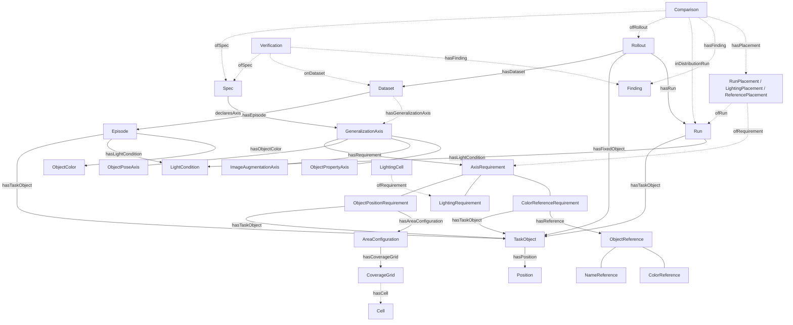

# Data Verification

This guide describes the data-verification tool. It extends steps 3 and 6 of
[Getting Started](getting_started.md): a dataset is checked before training
against its specs, and the results are used again when a trained policy fails.
After a rollout, the dataset is also compared with the conditions the rollout
actually used ([section 5](#5-compare-the-dataset-with-a-rollout)).

All of it goes through one **verification store** per dataset: a directory of
RDF (Turtle) files that records the dataset, the specs, and every
verification result, and that can be queried with SPARQL
([section 6](#6-query-the-store)).

Every section starts with one of two labels: **Required** (steps to carry out)
or **Background** (explanation without work items).

## 1. The three generalization axes

**Background**

Imitation-learning policies tend to perform well only in situations that the
demonstrations represent well. If evaluation shows the policy a situation the
dataset has few or no episodes of, the policy may fail because of missing data
rather than because of the model. The check makes "represent well" concrete
along three axes.

The axes follow STAR-Gen (Gao et al., "A Taxonomy for Evaluating Generalist
Robot Manipulation Policies", arXiv:2503.01238). Each axis checks one STAR-Gen
factor; the dataset columns and the rollout-log keys use the factor's name.

| STAR-Gen axis | Factor checked | Axis class / spec file | Data | Guide |
|---|---|---|---|---|
| Object Poses, VB-POSE (visual and behavioral) | object position (STAR-Gen: manipulated object pose; position only) | `cp:ObjectPoseAxis` / `object_pose.ttl` | `object_position.<obj>` `[x, y, z]` | [Object Poses](object_pose.md) |
| Image Augmentations, V-AUG (visual) | lighting | `cp:ImageAugmentationAxis` / `image_augmentation.ttl` | `lighting.<light>` `[intensity, color_temperature]` | [Image Augmentations](image_augmentation.md) |
| Object Properties, S-PROP (semantic) | referencing objects based on color | `cp:ObjectPropertyAxis` / `object_property.ttl` | episode task text, `object_color.<obj>` `[r, g, b]` | [Object Properties](object_property.md) |

Axes are chosen by passing one spec file per axis; an axis without a spec is
not checked ([section 3](#3-specs)).

## 2. Workflow

**Required**

```text
record ──▶ ingest --dataset ──▶ copy and fill specs ──▶ verify --spec ──▶ explore / query / record where data is thin ──┐
  ▲  (object_position.*, lighting.*, object_color.* columns, task text)                                              │
  └──────────────────────────────────────────────────────────────────────────────────────────────────────────────────┘
```

| Step | Runs in | Command |
|---|---|---|
| Record, with the factor columns | Simulator environment | `generate.py` or `teleop.py` with `--use_lerobot_recorder` ([Data Collection §5](data_collection.md#5-the-recorder-and-the-dataset)) |
| Put the dataset into a store | General environment | `scripts/store.py ingest --dataset` |
| Copy the specs and fill them in | Any editor | [Section 3](#3-specs) |
| Check the dataset | General environment | `scripts/store.py verify --spec` ([section 4](#4-run-the-check-and-read-the-report)) |
| Compare a rollout with the dataset | General environment | `scripts/store.py compare --spec --rollout-log` ([section 5](#5-compare-the-dataset-with-a-rollout)) |
| Look at the results | General environment | `scripts/store.py explore`, `query` ([section 6](#6-query-the-store)) |

The whole round, from the repository root:

```bash
uv run python scripts/store.py ingest --dataset datasets/${HF_USER}/<repo_name>
mkdir -p my_specs
cp specs/<task>/object_pose.ttl my_specs/   # fill every "TODO"
uv run python scripts/store.py verify --store stores/<repo_name> --spec my_specs/object_pose.ttl
uv run python scripts/store.py compare --store stores/<repo_name> --spec my_specs/object_pose.ttl \
    --rollout-log outputs/rollout/<timestamp>.jsonl
uv run python scripts/store.py explore --store stores/<repo_name>
uv run python scripts/store.py query --store stores/<repo_name> --query-file queries/uncovered_cells.rq
```

| Argument | Meaning |
|---|---|
| `--dataset <path>` | The LeRobot dataset directory to ingest; the store is created from it |
| `--store <path>` | The store to work on (`stores/<repo_name>`) |
| `--rollout-log <file>` | A rollout log for `compare`; it is read at each call and never ingested; `compare` stores only its result |
| `--spec <file>` | The spec to check or compare with; append the specs of other axes after it to check them in the same run |
| `--query-file <file>` | A SPARQL file to run |

`ingest --dataset` creates `stores/<repo_name>/dataset.ttl`: the dataset,
each episode with its frame count, task text, and the values of every factor
at the episode's first recorded frame, plus the dataset's path, a fingerprint
of its files, and the time of the ingest.

| Option of `ingest --dataset` | Effect |
|---|---|
| `--name <name>` | Store name (default: the dataset directory name); the store is `stores/<name>` |
| `--task <task_id>` | Records the gym task the dataset was recorded with (`cp:task`) |
| `--stores <dir>` | Directory of stores (default: `stores`) |

Run `ingest --dataset` again after recording more episodes. It rewrites
`dataset.ttl` and removes the previous verification results, which described
the old episodes; the specs stay.

The store reads only `meta/info.json`, `meta/tasks.parquet` and
`data/**/*.parquet` of the dataset. It never starts the simulator and never
decodes video, so every step runs in seconds. The LeRobot dataset itself
remains unchanged, and can still be used for training and uploaded to the
Hugging Face Hub.

## 3. Specs

**Required**

A spec is a small text file in [Turtle](https://www.w3.org/TR/turtle/) format
that states the requirement for one axis. The repository ships one
spec per axis and task, with every value set to `"TODO"`:

```text
specs/<task>/object_pose.ttl           Object Poses           (object_pose.md)
specs/<task>/image_augmentation.ttl    Image Augmentations    (image_augmentation.md)
specs/<task>/object_property.ttl       Object Properties      (object_property.md)
```

1. Copy the specs of the axes to check, for example into `my_specs/`. Each
   file is commented; the axis guide explains every field and how to choose
   its value.
2. Replace every `"TODO"`. Numbers are written **without quotes** (`8.8`, not
   `"8.8"`); text, such as object names and phrases, keeps its quotes.
3. Pass the files to `verify --spec`
   ([section 4](#4-run-the-check-and-read-the-report)).

Rules:

- **One spec file per axis.** An axis without a spec file is not checked.
  With several spec files, `compare` also judges each rollout on all of them
  together ([section 5](#5-compare-the-dataset-with-a-rollout)). A file may
  also declare several axes (copy the blocks of two shipped specs into one
  file).
- **The file name is the spec's name** in the store and in reports (the name
  without `.ttl`, e.g. `object_pose`). Two spec files with the same name in
  one `verify` are an error, even from different directories.
- **Each file is checked before it is used**: no `TODO` left, numbers
  unquoted, whole numbers where required, ranges not empty. A spec with a
  problem is reported as `ERROR` lines and not checked; the other specs are
  still checked.
- **The store keeps exactly the specs of the last `verify`.** Each given file
  is copied into `stores/<repo_name>/specs/<name>.ttl`; a spec from an
  earlier `verify` that is not given again is removed with its results. A
  rejected spec is removed too.
- When copied into the store, the spec's nodes are renamed under the store's
  IRI for that spec (`spec:blue_cup_grid` becomes
  `…/spec/object_pose/blue_cup_grid`), so several copies of one shipped spec,
  for example a coarse and a fine grid in `coarse.ttl` and `fine.ttl`, can
  share one store.

## 4. Run the check and read the report

**Required**

```bash
uv run python scripts/store.py verify --store stores/<repo_name> --spec my_specs/object_pose.ttl
```

To check another axis in the same run, append its spec file after the first
one: `--spec my_specs/object_pose.ttl my_specs/image_augmentation.ttl` is the
same as repeating the flag, `--spec my_specs/object_pose.ttl --spec
my_specs/image_augmentation.ttl`. `verify` checks the recorded dataset against
every given spec, prints one report per spec, and writes the results into
`stores/<repo_name>/findings/`. It never reads a rollout log; that is
[`compare`](#5-compare-the-dataset-with-a-rollout). Reports are separated by a
line of `=`. It also draws the coverage grids as heatmaps into
`stores/<repo_name>/figures/` (one PNG per object or light), so even a
100 × 100 grid can be read; `--no-figures` skips them. The terminal shows no
grid tables.

**Every `verify` replaces the dataset figures.** The folder holds the figures
of the last `verify` only, like the specs and findings. Verifying only the
Object Poses spec therefore deletes the lighting figure of an earlier run that
checked the Image Augmentations spec. To keep all figures, check every axis in
one run (`--spec a.ttl b.ttl c.ttl`) or copy the PNGs elsewhere first.
(`compare` writes its figures to `figures/compare/` and leaves these alone.)

Long lists are cut so the report stays readable: each verifier prints at most
10 `VIOLATION`, `WARNING` or `ERROR` lines, the hints at most 15, followed by
`... and N more ...`. The full lists are in `findings/`.

Every report has the same frame. On a terminal it is drawn as tables (a header
box, one table per object, light or reference, a findings table, and a coloured
`RESULT` line); a colour is always accompanied by its word (`met`, `NOT met`,
`seen`, `unseen`), so nothing depends on it. When the output is redirected to a
file or a pipe, or with `--format text`, it is plain text, which the examples
below show. Example, for an Object Poses spec:

```
Store   : stores/<repo_name>
Spec    : object_pose  (/home/<user>/<repo>/my_specs/object_pose.ttl)
Episodes: 12

[blue_cup] x=8.800..9.000  y=6.400..6.600  covered 3/4 cells (>= 3 each)

VIOLATION 'blue_cup' cell (i=1, j=1) x=[8.9, 9] y=[6.5, 6.6] has 1 episode(s); needs at least 3  [spec/object_pose/blue_cup_grid/cell/3]

RESULT: coverage spec NOT met

Findings written to stores/<repo_name>/findings/
Figures written to stores/<repo_name>/figures/ (1):
  stores/<repo_name>/figures/object_pose__blue_cup.png
```

How to read it:

- **Header**: the store, the spec (its name and the file it came from) and
  the number of episodes.
- **Axis blocks** (`[blue_cup] …`): a summary line per object, light or
  reference of each axis in the spec, with the coverage figures written next to
  the report. Their
  meaning is in the axis guides: [Object Poses](object_pose.md),
  [Image Augmentations](image_augmentation.md),
  [Object Properties](object_property.md).
- **ERROR**: the check could not run (a `TODO` left, a missing column, the
  dataset changed after it entered the store, ...). See
  [section 8](#8-troubleshooting).
- **VIOLATION**: a requirement is not met, for example a cell or a reference
  with too few episodes.
- **WARNING**: allowed but worth knowing, for example an episode outside the
  required area or range; it does not count toward coverage.
- The text in `[...]` at the end of a line names the nodes the finding is
  about (at most 3, then `(+N more)`).
- **RESULT**: `coverage spec met` when the spec has no error and no violation.

Every line of the report is also stored as a `cp:Finding` in
`findings/<spec>.ttl`, together with derived numbers such as each cell's
episode count, so the same results can be queried later
([section 6](#6-query-the-store)).

| Option of `verify` | Effect |
|---|---|
| `--spec a.ttl [b.ttl ...]` | **Required.** The spec file; append more files (one per axis) to check several axes; repeatable |
| `--format auto\|table\|text` | Report layout: `auto` (default) prints tables on a terminal and plain text when the output is redirected (logs, CI); `table` and `text` force one |
| `--no-figures` | Does not write the coverage heatmaps |
| `--json result.json` | Also writes the full result (counts, findings) as JSON |
| `--strict` | Also fails on warnings |
| `--extra-shapes my_rules.ttl` | Also runs custom SHACL rules in the dataset check ([section 7](#7-how-it-works-rdf-owl-shacl)); repeatable |

Exit code: `0` when every spec is met, `1` otherwise; warnings also fail with
`--strict`. A collection script can use the exit code, for example, to stop
collecting once coverage is reached (run `ingest --dataset` before each
`verify`).

`explore` prints a summary of the store: the dataset, the specs of the last
`verify` with their result, and the rollouts of the stored `compare` results.
`STALE` marks a source that changed after it entered the store.

```bash
uv run python scripts/store.py explore --store stores/<repo_name>
```

```
Store   : stores/<repo_name>
Dataset : /home/<user>/<repo>/datasets/<user>/<repo_name>  (ingested 2026-11-20T15:57:59+00:00)
          12 episode(s); objects blue_cup, pink_cup
          robot: franka_panda
          fps: 30

Specs
  object_pose: /home/<user>/<repo>/my_specs/object_pose.ttl; axes object_pose_axis (cp:ObjectPoseAxis); 2 requirement(s)
    verified 2026-11-20T15:58:08+00:00: NOT passed; 1 Violation

Comparisons
  20261103-142530: 8/20 succeeded; eval eval/cup_stacking_eval.py, seed 42
    vs object_pose: 5 run(s) in distribution; 4 Info, 1 Warning

Query it: query --store stores/<repo_name> --query-text 'SELECT ...'  (examples in queries/)
```

## 5. Compare the dataset with a rollout

**Required**

The dataset check compares the dataset with the specs. After a policy has been
evaluated, the comparison asks a second question: **did the dataset cover the
conditions the rollout actually used?** It reads each rollout episode (run):
the factor values it started with and whether it succeeded. It then shows the
runs that started where the dataset is thin, together with what to record
next. Repeating record, train, rollout and compare closes those gaps one round
at a time.

### 5.1 The rollout log

Every rollout ([Rollout §3](rollout.md#3-run-rollout)) writes
`outputs/rollout/<timestamp>.jsonl`, with no flag needed. The first line is a
header; then one line per episode:

```text
{"type": "header", "version": 1, "eval_file": "eval/cup_stacking_eval.py", "eval_sha256": "…", "task": "…", "seed": 42, "checkpoint": "…", "num_envs": 1, "episode_length_s": …, "robot_base": {"pos": […], "rot": […]}, "fixed_objects": {}}
{"type": "episode", "episode": 0, "status": "succeeded", "factors": {"object_position": {"blue_cup": [8.85, 6.45, 0.9], "pink_cup": [9.05, 6.43, 0.9]}, "lighting": {"rect_light": [5000.0, 5600.0]}}, "instruction": "pick up the blue cup and place it on the pink cup."}
```

| Key | Content | Used by |
|---|---|---|
| `status` | `succeeded`, `failed` or `aborted` (stopped by a manual reset; kept but not counted) | every axis |
| `factors.object_position` | Each randomized object's position right after the reset, `[x, y, z]`, env-local frame (the frame of the dataset columns) | [Object Poses](object_pose.md) |
| `factors.lighting` | Each recorded light's `[intensity, color_temperature]` at the same moment | [Image Augmentations](image_augmentation.md) |
| `instruction` | The task text the policy was given | [Object Properties](object_property.md) |
| Header `robot_base`, `fixed_objects` | Poses of what does not move between episodes, once | Stored (`cp:hasFixedObject`), not compared |

The log is written line by line while the rollout runs, so a rollout stopped
with Ctrl+C still leaves a readable log. `compare` reads the file as it is at
that moment, so run it after the rollout has ended; the next `compare` reads
the file again.

### 5.2 Compare

`compare` takes the store of the dataset the evaluated policy was trained on,
the specs, and the log:

```bash
uv run python scripts/store.py compare --store stores/<repo_name> \
    --spec my_specs/object_pose.ttl \
    --rollout-log outputs/rollout/<timestamp>.jsonl
```

| Argument | Meaning |
|---|---|
| `--store stores/<repo_name>` | The store of the dataset the evaluated policy was trained on (made by `ingest --dataset`) |
| `--spec <file>` | The spec to compare with; append more files (one per axis), as in [section 4](#4-run-the-check-and-read-the-report) |
| `--rollout-log <file>` | **Required.** The rollout log; append more files to compare several rollouts, one report each |
| `--no-hints` | Leaves the suggested next steps out of the report |
| `--format auto\|table\|text` | Report layout, as for `verify` |
| `--no-save` | Does not write the comparison to `stores/<repo_name>/findings/` |
| `--no-figures` | Does not write the heatmaps to `stores/<repo_name>/figures/compare/` |
| `--json result.json` | Also writes the full result as JSON |
| `--strict` | Also fails on warnings |

What `compare` puts side by side: the **dataset's coverage** (from the store's
`dataset.ttl`: how many episodes each cell, light or reference of each
requirement in your spec has) and **each finished run of the log** (the factor
values it started with and whether it succeeded). The log is **never
ingested** and there is no `rollouts/` folder: the log and the specs are read
at each call, so an old or still-running rollout never shows up in another
comparison. `compare` writes only its result, the runs it judged and the
`Comparison`, to `findings/<spec>__<rollout>.ttl` (replaced by the next
`compare` of the same spec and log; `--no-save` skips it). `verify` of a spec
deletes that spec's comparison files, since the spec may have changed. When the checkpoint has a `train_config.json` naming a
different dataset, it warns.

`compare` does not run the dataset check; run [`verify`](#4-run-the-check-and-read-the-report)
for that. It needs only the ingested dataset, and stops with an `ERROR` when
the dataset changed since `ingest --dataset`. Each comparison is printed as
its own report (exit code `0` when every comparison could be made, `1`
otherwise; uncovered runs are warnings, not failures):

```
Store   : stores/<repo_name>
Spec    : object_pose
Rollout : 20261103-142530  (eval/cup_stacking_eval.py, seed 42)
Runs    : 20 finished, 8 succeeded

[blue_cup] your area ...                (one block per requirement of each axis)

In distribution (covered on every axis: object_pose): 5/20 runs (25%)
  success 4/5 in distribution vs 4/15 outside

Record more episodes here ...           (hints of each axis, unless --no-hints)

WARNING   ...

RESULT: the dataset does NOT cover every rollout run; see above
```

- **Covered.** Each axis decides, per finished run, whether the dataset covers
  it. The rule of each axis is in its guide.
- **In distribution.** A run is in distribution when it is covered on **every
  axis of the spec**. The line compares the success rate inside with the rate
  outside; a much lower rate outside points to missing data rather than the
  model.
- **RESULT**: `the dataset covers every rollout run`, `the dataset does NOT
  cover every rollout run; see above`, or `comparison could not be made`
  (an `ERROR`).

**Combined verdict.** Each report above judges the axes of one spec file.
When two or more spec files are given, `compare` ends with one more block per
rollout, `COMBINED (all spec files together)`: a run counts as in distribution
there only when **every** spec file puts it in distribution. Example, with
`image_augmentation.ttl` and `object_property.ttl` on a dataset of 6
episodes, all by name and all with the same light, and a synthetic rollout of
10 runs (made up for illustration, not from a trained policy):

```
COMBINED (all spec files together)
Rollout : 2026-11-21_10-00-00
Specs   : image_augmentation, object_property

In distribution on every axis (image_augmentation, object_property): 4/10 runs (40%)
  success 3/4 in distribution vs 2/6 outside

RESULT: the dataset does NOT cover every rollout run on every axis
```

Each spec file alone puts 6 of the 10 runs in distribution (the runs with the
recorded light; the runs that name the object). Only the 4 runs with both
are in distribution on every axis. A spec file that was rejected or whose
comparison failed is listed in a `NOTE` line and left out; the `RESULT` then
ends in `on every axis given`. With one spec file, there is no combined block;
its own report is the verdict. The JSON from `--json` has the same numbers
under `"combined"`.

## 6. Query the store

**Background**

Every fact and result in the store can be asked for with
[SPARQL](https://www.w3.org/TR/sparql11-query/), locally with `rdflib` (no
server):

```bash
uv run python scripts/store.py query --store stores/<repo_name> \
    --query-file queries/uncovered_cells.rq
uv run python scripts/store.py query --store stores/<repo_name> \
    --query-text 'SELECT (COUNT(?e) AS ?n) WHERE { ?e a cp:Episode }'
```

`--query-file` runs a SPARQL file, `--query-text` runs the query given inline.

`SELECT` prints a table (`--format csv` or `--format json` for files), `ASK`
prints `true` or `false`, and `CONSTRUCT`/`DESCRIBE` print Turtle. The
prefixes `cp:`, `rdf:`, `rdfs:`, `owl:` and `xsd:` are predefined.
`--with-ontology` also loads the classes and their labels.

The repository's `queries/` directory has examples to start from
([queries/README.md](../queries/README.md)). All but `findings.rq` are about
the Object Poses axis:

| File | Question |
|---|---|
| `episodes.rq` | Where did each object start in each recorded episode? (raw facts, no spec needed) |
| `cell_counts.rq` | How many dataset episodes does each cell of each spec have? |
| `uncovered_cells.rq` | Which cells have fewer episodes than required, and how many more each needs? |
| `run_outcomes_by_cell.rq` | How many rollout runs started in each cell, and how many succeeded? |
| `failed_runs_not_covered.rq` | Which failed runs started where the dataset does not cover? |
| `findings.rq` | Every stored finding of every axis, by spec, rollout and severity (`verify` and `compare`) |

For example, which axis and factor of STAR-Gen each axis class stands for:

```bash
uv run python scripts/store.py query --store stores/<repo_name> --with-ontology \
    --query-text 'SELECT ?class ?axis WHERE { ?class cp:starGenAxis ?axis }'
```

Numbers are compared with `FILTER`: `?e cp:index ?i . FILTER (?i = 2)` finds
episode 2, while `?e cp:index 2` finds nothing, because indices are stored as
`xsd:nonNegativeInteger` and `2` is an `xsd:integer`. Custom queries can be
kept in `stores/<repo_name>/queries/`.

## 7. How it works: RDF, OWL, SHACL

**Background**

This section is not needed to use the tool.

| Piece | In one sentence | File (under `packages/data_verification/src/data_verification/`) |
|---|---|---|
| **RDF** | Data stored as `subject → predicate → object` facts, e.g. `episode/3/object/blue_cup/position → cp:positionX → 8.91` | Written into the store by `store.py` and `graph.py` |
| **OWL** | The vocabulary: kinds of things and the properties linking them (below) | `ontology/core.ttl` (store, dataset, rollout, results) and `axes/<axis>/ontology.ttl` (one per axis) |
| **Spec** | The requirement, written as RDF in that vocabulary | The spec `.ttl` files, copied into the store by `verify` |
| **SHACL** | Rules: each rule selects nodes (every episode, every cell, ...) and states what must hold | `shapes/dataset.ttl`, `shapes/rollout.ttl` (any axis) and `axes/<axis>/shapes.ttl`, `rollout_shapes.ttl` |
| **Verifier** | One per axis: its ontology, its SHACL rules, the checks of its spec, and optional Python steps (counts, tables, run placements, hints), registered in `registry.py` | `verifier.py`, `registry.py`, `axes/<axis>/` |

The three axis modules:

| Directory | Verifier name | Axis class (`cp:starGenAxis`) | Requirement class (`cp:starGenFactor`) |
|---|---|---|---|
| `axes/object_pose/` | `object_pose` | `cp:ObjectPoseAxis` (`VB-POSE`) | `cp:ObjectPositionRequirement` (`manipulated object pose (position only)`) |
| `axes/image_augmentation/` | `image_augmentation` | `cp:ImageAugmentationAxis` (`V-AUG`) | `cp:LightingRequirement` (`lighting`) |
| `axes/object_property/` | `object_property` | `cp:ObjectPropertyAxis` (`S-PROP`) | `cp:ColorReferenceRequirement` (`referencing objects based on color`) |

`cp:starGenAxis` and `cp:starGenFactor` are annotations on the classes in each
`ontology.ttl`; they link the repository's names to the taxonomy.

The store is one directory per dataset. Each file is rewritten as a whole, so
an interrupted command never leaves half a file:

```text
stores/<repo_name>/
├── dataset.ttl                       ingest --dataset
├── specs/<spec>.ttl                  verify --spec: the spec (renamed), derived nodes such as grid cells
├── findings/<spec>.ttl               verify: the dataset against the spec
├── findings/<spec>__<rollout>.ttl    compare: the rollout's runs against the spec
├── figures/*.png                     verify: coverage heatmaps (all replaced on every verify)
├── figures/compare/*.png             compare: heatmaps with the rollout runs (replaced on every compare)
└── queries/                          custom SPARQL queries
```

What enters the store is never derived: `ingest` and `verify --spec` record
facts and the spec's declarations, each with its source path, a hash and a
time (`cp:sourcePath`, `cp:sourceSha256`, `cp:ingestedAt`). `verify` adds
result nodes that point at those facts, and replaces them on the next run.
Rollout logs are never ingested: `compare` turns each log into facts
(`Rollout`, `Run`, `RunPlacement`, in the trees below) in memory and stores
only the result, in `findings/<spec>__<rollout>.ttl`.

The core vocabulary, as a tree (dotted links ┄ are added by `verify`; the rest
is written in the spec or recorded by `ingest`). Each axis adds its own
subclasses of `GeneralizationAxis` and `AxisRequirement` and the nodes below
them; the axis guides show them.

```text
Dataset (name, recordedObject, task, robotType, fps, sourcePath, sourceSha256)
├┄ hasGeneralizationAxis ▶ GeneralizationAxis     ObjectPoseAxis, ImageAugmentationAxis, ObjectPropertyAxis
│      └─ hasRequirement ▶ AxisRequirement         ObjectPositionRequirement, LightingRequirement, ColorReferenceRequirement
└─ hasEpisode
    ▶ Episode (index = episode_index, frameCount, taskDescription)
       └─ hasTaskObject ▶ TaskObject (name) ─ hasPosition ▶ Position (positionX, positionY, positionZ)

Spec (name, sourcePath, sourceSha256)
└─ declaresAxis ▶ GeneralizationAxis …

Verification (verifiedAt, passed)                 (verify)
├─ ofSpec ▶ Spec
├─ onDataset ▶ Dataset
└─ hasFinding ▶ Finding (severity, message, verifier, focusNode)

Rollout (name, evalFile, evalSha256, seed, checkpoint, trainedOnRepo, successEpisodes, totalEpisodes)
├─ hasDataset ▶ Dataset
├─ hasFixedObject ▶ TaskObject (name) ─ hasPosition ▶ Position
└─ hasRun ▶ Run (index, status)                   one rollout episode: succeeded, failed or aborted

Comparison (verifiedAt, runsInDistribution)       (verify)
├─ ofSpec ▶ Spec
├─ ofRollout ▶ Rollout
├─ inDistributionRun ▶ Run                        every axis of the spec covers it
├─ hasPlacement ▶ (one per run and requirement; class of the axis)
└─ hasFinding ▶ Finding
```

- The dataset *has* the axes of its specs; their requirements apply to its
  episodes only. Each spec is verified with only its own axes.
- `Run` and `Episode` are different classes, so a run never counts as dataset
  coverage. `totalEpisodes` counts the finished runs and `successEpisodes` the
  succeeded ones; aborted runs are kept but counted in neither.
- A `Finding` has a severity: `Error` (the check could not be made),
  `Violation` (a requirement is not met), `Warning`, or `Info` (a suggested
  next step).

The same vocabulary as a diagram, with the three axis modules. Solid arrows
are written by `ingest` or in the spec; dotted arrows are added by `verify`.



Lines without an arrowhead (`---`) are subclass relations.

What `verify` does, per given spec file:

1. Checks the spec (no `TODO`, value types, ranges) and copies it into
   `specs/<name>.ttl` with its nodes renamed and derived nodes (such as grid
   cells) added.
2. Loads `dataset.ttl` and the spec from the store, and stops with an `ERROR`
   when the dataset changed since it entered the store or a column the spec
   needs is missing.
3. Runs the SHACL rules of the store and of every axis of the spec over both
   with [`pyshacl`](https://github.com/RDFLib/pySHACL).
4. Runs each axis's Python step (per-cell counts, per-reference counts,
   tables).
5. Prints each failed rule as one `VIOLATION` or `WARNING` line, plus the
   tables, and writes the `Verification` with its findings and derived counts
   to `findings/<name>.ttl`.

`compare` does the following per given spec file and rollout log: it reads the
log into `Rollout` and `Run` facts, runs the rollout SHACL rules, lets each
axis judge every finished run, marks the runs every axis covers as
`inDistributionRun` in the `Comparison`, and writes the `Comparison` with the
runs to `findings/<name>__<rollout>.ttl`.

Additional rules are written as SHACL shapes in a separate `.ttl` file and
passed with `verify --extra-shapes`; they run in the dataset check. An example
is in [Object Poses §8](object_pose.md#8-how-it-works).

## 8. Troubleshooting

**Background**

General messages. Messages of one axis are in its guide
([Object Poses §6](object_pose.md#6-troubleshooting),
[Image Augmentations](image_augmentation.md),
[Object Properties](object_property.md)).

| Message | Cause | Fix |
|---|---|---|
| `… is not a store (no dataset.ttl); create it with: ingest --dataset <dataset>` | `--store` points to a directory without an ingested dataset | Run `ingest --dataset` first, or fix the path |
| `Not a LeRobot dataset: …/meta/info.json does not exist` | `--dataset` points to the wrong directory | Pass the dataset directory (the one with `meta/` and `data/`) |
| `meta/info.json declares no 'object_position.<name>' features; …` | Dataset recorded without `--use_lerobot_recorder` | Record again with the option ([Data Collection §5](data_collection.md#5-the-recorder-and-the-dataset)) |
| `… is missing columns: …` | A parquet shard lacks a column that `meta/info.json` declares | Record with the repository recorder |
| `Dataset contains no episodes` | Empty dataset | Record episodes first |
| `N episode(s) do not start at frame_index 0: …` | Dataset edited or written by another tool | Record with the repository recorder |
| `The dataset … changed after it entered the store; run: ingest --dataset …` | Episodes were recorded or files changed after the last ingest | Run the printed `ingest` command, then `verify` |
| `STALE: The spec … changed after it entered the store; run: verify --spec …` (in `explore`) | The spec file was edited after the last `verify` | Run `verify` again with the spec |
| `the following arguments are required: --spec` | `verify` or `compare` without `--spec` | Pass the spec to check: `--spec my_specs/object_pose.ttl` (append further specs to check more axes) |
| `Two spec files are both named '<name>.ttl'; give each spec its own file name` | Two `--spec` files with the same file name, e.g. from two directories | Rename one; the file name is the spec's name in the store |
| `Spec file not found: …` | Wrong path | Fix the path |
| `Spec is not valid Turtle: …` | Syntax error, usually a missing `;` or `.` | Compare with the shipped spec: `;` between the fields of one block, `.` at the end of a block |
| `Spec still has TODO values: …` | Unfilled fields, listed as `<owner>: <field>` | Fill them in ([section 3](#3-specs)) |
| `… must be a number without quotes, got "8.8"` | Quoted number | Write `8.8`, not `"8.8"` |
| `… must be a whole number without quotes, got 2.5` | Fraction where a count is needed | Use a whole number |
| `Spec declares no generalization axis with a registered verifier (…)` | The axis line (e.g. `spec:object_pose_axis a cp:ObjectPoseAxis .`) is missing or names another class | Restore it from the shipped spec |
| `… is typed cp:GeneralizationAxis; use the class of a registered axis (e.g. cp:ObjectPoseAxis)` | The axis uses the general class | Use the class of the shipped spec |
| `Spec name '…' must use only letters, digits, '-', '_' and '.', without '__'` | The spec file name has other characters | Rename the file |
| `Dataset has no 'object_position.<name>' column, which the spec requires` (or `'lighting.<name>'`, `'object_color.<name>'`) | The spec names an object or light the dataset did not record, or the dataset was recorded before the task recorded that factor | Fix the name in the spec, or record with the repository recorder; see the axis guide |
| `unrecognized arguments: --rollout-log …` (from `verify`), or `ingest` has no `--rollout-log` | Rollout logs are no longer ingested or checked by `verify` | Use `compare --store … --spec … --rollout-log …` |
| `the following arguments are required: --rollout-log` | `compare` without a log | Pass `--rollout-log outputs/rollout/<timestamp>.jsonl` |
| `Rollout log not found: …`, `…: the first line must be the rollout header`, `…: log version …, expected 1` | Wrong file, or a log not written by `scripts/rollout.py` | Pass `outputs/rollout/<timestamp>.jsonl` |
| `Rollout '…' has no finished run (all aborted or none run)` | Every episode of the log was aborted | Run the rollout again |
| `The rollout's checkpoint was trained on '…', not on …` (warning) | `--store` is the store of another dataset than the one the policy learned from | Compare with the training dataset's store |
| `Extra shapes file … could not be loaded: …` | The `--extra-shapes` file is not valid Turtle | Fix the file |
